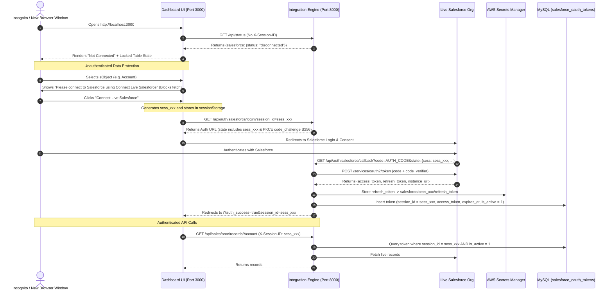

# System Architecture & Integration Patterns

This document details the architecture, data models, integration flows, and Docker topology for the Live Salesforce <-> AWS Integration Platform.

---

## 🏗️ System Topology

```
                               ┌───────────────────────────────────────────────┐
                               │         Live Salesforce Cloud (OAuth)         │
                               │           (https://login.salesforce.com)      │
                               └───────────────────────┬───────────────────────┘
                                                       │
                                   OAuth 2.0 Auth Code │ & Live REST/SOQL
                                   with PKCE (S256)    │
                                                       ▼
┌──────────────────────────────────────────────────────────────────────────────────────────────┐
│                                    Docker Compose Network                                    │
│                                                                                              │
│   ┌──────────────────────────────────────────────────────────────────────────────────────┐   │
│   │                         src/integration-engine (FastAPI)                             │   │
│   │                                   (Port 8000)                                        │   │
│   │  ┌───────────────────────┐  ┌──────────────────────┐  ┌───────────────────────────┐  │   │
│   │  │   OAuth 2.0 Service   │  │ LocalSecretsManager  │  │   SalesforceClient        │  │   │
│   │  │ (Session-Isolated PKCE)  │  (Boto3 / LocalStack)│  │   (Live SOQL & REST)      │  │   │
│   │  └───────────┬───────────┘  └──────────┬───────────┘  └─────────────┬─────────────┘  │   │
│   └──────────────┼─────────────────────────┼────────────────────────────┼────────────────┘   │
│                  │                         │                            │                    │
│                  ▼                         ▼                            ▼                    │
│   ┌───────────────────────────┐ ┌───────────────────────────┐ ┌──────────────────────────┐ │
│   │    MySQL Database (8.0)   │ │   AWS Secrets Manager     │ │     LocalStack AWS       │ │
│   │        (Port 3306)        │ │  (LocalStack / Cloud ARN) │ │       (Port 4566)        │ │
│   │ ┌───────────────────────┐ │ │ ┌───────────────────────┐ │ │ ┌─────────┐ ┌───────────┐ │ │
│   │ │ salesforce_oauth_     │ │ │ │ Refresh Tokens        │ │ │ │ AWS S3  │ │ DynamoDB  │ │ │
│   │ │ tokens (session_id)   │ │ │ │ (Never plain in DB)   │ │ │ ├─────────┤ ├───────────┤ │ │
│   │ ├───────────────────────┤ │ │ └───────────────────────┘ │ │ │ AWS SQS │ │ EventBridge│ │ │
│   │ │ salesforce_accounts   │ │ └───────────────────────────┘ └─────────┘ └───────────┘ │ │
│   │ ├───────────────────────┤ │                                                          │ │
│   │ │ salesforce_contacts   │ │                                                          │ │
│   │ ├───────────────────────┤ │                                                          │ │
│   │ │ salesforce_           │ │                                                          │ │
│   │ │ opportunities         │ │                                                          │ │
│   │ ├───────────────────────┤ │                                                          │ │
│   │ │ salesforce_custom_    │ │                                                          │ │
│   │ │ mappings              │ │                                                          │ │
│   │ └───────────────────────┘ │                                                          │ │
│   └───────────────────────────┘                                                          │ │
│                  ▲                                                                           │
│                  │                                                                           │
│   ┌──────────────┴────────────┐                                                              │
│   │     src/dashboard-ui      │                                                              │
│   │    (Vercel CLI @ 3000)    │                                                              │
│   │ (sessionStorage Isolated  │                                                              │
│   │  & Toast Notification Engine)│                                                           │
│   └───────────────────────────┘                                                              │
└──────────────────────────────────────────────────────────────────────────────────────────────┘
```

---

## 🔐 Browser Session Isolation & Strict Access Control



---

## 🗄️ Database Schemas (MySQL)

### Table: `salesforce_oauth_tokens`
- `id` (INT, PK, Auto Increment)
- `session_id` (VARCHAR 100, Indexed)
- `salesforce_user_id` (VARCHAR 100)
- `salesforce_username` (VARCHAR 255)
- `salesforce_org_id` (VARCHAR 100)
- `instance_url` (VARCHAR 255)
- `access_token` (TEXT)
- `refresh_token_secret_arn` (VARCHAR 255)
- `token_type` (VARCHAR 50, Default 'Bearer')
- `issued_at` (DATETIME)
- `expires_at` (DATETIME, Indexed)
- `last_refreshed_at` (DATETIME)
- `is_active` (BOOLEAN, Default TRUE)
- `created_at` (DATETIME)
- `updated_at` (DATETIME)

### Table: `salesforce_accounts`
- `id` (INT, PK, Auto Increment)
- `salesforce_id` (VARCHAR 18, UNIQUE, Indexed)
- `name` (VARCHAR 255)
- `type` (VARCHAR 100)
- `industry` (VARCHAR 100)
- `phone` (VARCHAR 50)
- `website` (VARCHAR 255)
- `annual_revenue` (DECIMAL 18,2)
- `raw_payload` (JSON)
- `sync_status` (VARCHAR 50, Default 'SYNCED')
- `created_at` (DATETIME)
- `updated_at` (DATETIME)

### Table: `salesforce_contacts`
- `id` (INT, PK, Auto Increment)
- `salesforce_id` (VARCHAR 18, UNIQUE, Indexed)
- `salesforce_account_id` (VARCHAR 18, Indexed)
- `first_name` (VARCHAR 100)
- `last_name` (VARCHAR 100)
- `email` (VARCHAR 255, Indexed)
- `phone` (VARCHAR 50)
- `title` (VARCHAR 100)
- `raw_payload` (JSON)
- `sync_status` (VARCHAR 50, Default 'SYNCED')
- `created_at` (DATETIME)
- `updated_at` (DATETIME)

### Table: `salesforce_opportunities`
- `id` (INT, PK, Auto Increment)
- `salesforce_id` (VARCHAR 18, UNIQUE, Indexed)
- `salesforce_account_id` (VARCHAR 18, Indexed)
- `name` (VARCHAR 255)
- `stage_name` (VARCHAR 100)
- `amount` (DECIMAL 18,2)
- `probability` (DECIMAL 5,2)
- `close_date` (DATE)
- `raw_payload` (JSON)
- `sync_status` (VARCHAR 50, Default 'SYNCED')
- `created_at` (DATETIME)
- `updated_at` (DATETIME)

---

## 🛡️ Universal Zero-Trust Disconnected Data Guard

All data inspection and synchronization routes are wrapped with the `require_authenticated_salesforce_session` dependency:

```
[Unauthenticated Client Request]
                │
                ▼
   [Dependency: require_authenticated_salesforce_session]
                │
         Is session_id present & token active in MySQL?
                ├── No ──► [HTTP 401 Unauthorized] ──► Dashboard UI clears tables & renders locked banner
                │
                └── Yes ─► [Execute Route Handler] ──► Return requested data
```

### Protected Endpoints & UI Views
- **CRM Live Explorers:** `GET /api/salesforce/records/{sobject}`, `POST /api/salesforce/records/{sobject}`
- **Admin Mapping Studio & MySQL Schema:** `GET /api/salesforce/describe/{sobject}`, `POST /api/salesforce/custom-query`, `GET /api/admin/mappings`, `GET /api/db/schema-for-sobject/{sobject}`, `POST /api/db/add-column`
- **Relational MySQL DB:** `GET /api/db/accounts`, `GET /api/db/contacts`, `GET /api/db/opportunities`
- **AWS Infrastructure:** `GET /api/aws/dynamodb/records`, `GET /api/aws/s3/files`, `GET /api/aws/s3/file`, `GET /api/aws/sqs/stats`
- **Secrets & Governance:** `GET /api/secrets`, `GET /api/logs`
- **Sync Triggers & UI:** `POST /api/sync/record`, `POST /api/sync/salesforce-to-aws`, `POST /api/sync/aws-to-salesforce` (Sync Pipelines tab is completely hidden when disconnected)

---

## 🛠️ Admin Custom Mapping & On-Demand Dynamic MySQL Column Architecture

```
┌───────────────────────────────┐               ┌─────────────────────────────────────────┐
│     Dashboard UI (Port 3000)  │               │      Integration Engine (Port 8000)     │
│   (Admin Mapping Studio Tab)  │               │                                         │
└───────────────┬───────────────┘               └────────────────────┬────────────────────┘
                │                                                    │
                │ 1. GET /api/salesforce/describe/{sobject}          │
                ├───────────────────────────────────────────────────►│ (Introspects Live SF Fields)
                │                                                    │
                │ 2. GET /api/db/schema-for-sobject/{sobject}        │
                ├───────────────────────────────────────────────────►│ (Inspects information_schema)
                │                                                    │
                │◄───────────────────────────────────────────────────┤
                │ (Populates dropdowns with actual MySQL columns)    │
                │                                                    │
                │ 3. User clicks "+ New DB Field"                    │
                │    POST /api/db/add-column                         │
                ├───────────────────────────────────────────────────►│ (Sanitizes identifier & type)
                │    {sobject, column_name, data_type}               │ ALTER TABLE <table> ADD COLUMN
                │                                                    │
                │◄───────────────────────────────────────────────────┤
                │ (Auto-maps new MySQL column to active SF field)    │
                │                                                    │
                │ 4. POST /api/salesforce/custom-query               │
                ├───────────────────────────────────────────────────►│ (Builds dynamic SOQL & maps)
                │                                                    │
```

---

## 📦 Salesforce DX Repository Structure (`force-app`)

```
.
├── force-app/                  # Salesforce DX source format root
│   └── main/
│       └── default/
│           ├── applications/   # Custom & standard application definitions
│           ├── aura/           # Aura components
│           ├── classes/        # Apex classes & controllers
│           ├── contentassets/  # Salesforce files & asset files
│           ├── flexipages/     # Lightning App & Record pages
│           ├── layouts/        # Page layouts
│           ├── lwc/            # Lightning Web Components
│           ├── objects/        # Custom Objects, fields & validation rules
│           ├── permissionsets/ # Permission sets
│           ├── staticresources/# Static resources (CSS, JS bundles, images)
│           ├── tabs/           # Custom tabs
│           └── triggers/       # Apex database triggers
├── config/
│   └── project-scratch-def.json # Scratch org configuration
├── manifest/
│   └── package.xml             # Metadata API deployment manifest
├── scripts/
│   └── salesforce/
│       ├── apex/hello.apex     # Anonymous Apex execution scripts
│       ├── cypher/account.cypher # OpenCypher graph queries for Media Accounts
│       ├── soql/account.soql   # Ad-hoc SOQL queries (including Media search)
│       └── soql/media_accounts.soql # Dedicated Media Account SOQL query
├── sfdx-project.json           # Salesforce DX project definition & sourceApiVersion
└── .forceignore                # Salesforce metadata deployment exclusion rules
```

---

## 🔍 SOQL & OpenCypher Graph Query Architecture

The platform supports multi-model data access patterns across both standard relational Salesforce CRM SOQL and Graph Databases (Neo4j, Memgraph, AWS Neptune openCypher):

```
┌──────────────────────────────────────────────┐
│        Dashboard UI / User Query Intent      │
│   "Search All Media Type of Account" Action  │
└──────────────────────┬───────────────────────┘
                       │
                       ▼
┌──────────────────────────────────────────────┐
│  FastAPI Integration Engine (salesforce_client)│
├──────────────────────────────────────────────┤
│ 1. SOQL Builder:                             │
│    SELECT Id, Name, Type, Industry ...       │
│    WHERE Type = 'Media' OR Industry = 'Media'│
│                                              │
│ 2. OpenCypher Graph Translator (to_cypher):  │
│    MATCH (a:Account)                         │
│    WHERE a.Type = 'Media' ... RETURN a       │
└──────────────┬───────────────────────────────┘
               │
      ┌────────┴────────┐
      ▼                 ▼
┌──────────────┐ ┌──────────────┐
│ Live SF Org  │ │ Graph Engine │
│ (REST SOQL)  │ │(Neo4j/Neptune)
└──────────────┘ └──────────────┘
```

### Multi-Object Query Mapping Comparison:

| **Entity** | **NLP Sample Intent** | **Salesforce SOQL** | **openCypher Graph Query** |
| :--- | :--- | :--- | :--- |
| **Account** | `"Search All Media Type of Account"` | `SELECT Id, Name, Type, Industry, AnnualRevenue, Phone, BillingCity, BillingCountry, CreatedDate, LastModifiedDate FROM Account WHERE (Type = 'Media' OR Industry = 'Media' OR Type LIKE '%Media%' OR Industry LIKE '%Media%' OR Name LIKE '%Media%') ORDER BY LastModifiedDate DESC LIMIT 50` | `MATCH (a:Account) WHERE (a.Type = 'Media' OR a.Industry = 'Media' OR toLower(a.Type) CONTAINS 'media' OR toLower(a.Industry) CONTAINS 'media' OR toLower(a.Name) CONTAINS 'media') RETURN a.Id, a.Name, a.Type, a.Industry, a.AnnualRevenue, a.Phone ... ORDER BY a.LastModifiedDate DESC LIMIT 50` |
| **Contact** | `"Contacts with VP or Director title"` | `SELECT Id, FirstName, LastName, Email, Title, AccountId, Phone, CreatedDate, LastModifiedDate FROM Contact WHERE (Title LIKE '%VP%' OR Title LIKE '%Vice President%' OR Title LIKE '%Director%') ORDER BY LastModifiedDate DESC LIMIT 50` | `MATCH (c:Contact) WHERE (toLower(c.Title) CONTAINS 'vp' OR toLower(c.Title) CONTAINS 'director') RETURN c.Id, c.FirstName, c.LastName, c.Email, c.Title, c.AccountId, c.Phone ... ORDER BY c.LastModifiedDate DESC LIMIT 50` |
| **Opportunity** | `"Closed Won deals > $50k"` | `SELECT Id, Name, StageName, Amount, CloseDate, Probability, AccountId, CreatedDate, LastModifiedDate FROM Opportunity WHERE StageName = 'Closed Won' AND Amount >= 50000 ORDER BY LastModifiedDate DESC LIMIT 50` | `MATCH (o:Opportunity) WHERE o.StageName = 'Closed Won' AND o.Amount >= 50000 RETURN o.Id, o.Name, o.StageName, o.Amount, o.CloseDate, o.Probability ... ORDER BY o.LastModifiedDate DESC LIMIT 50` |
| **Lead** | `"Qualified leads with email"` | `SELECT Id, FirstName, LastName, Company, Email, Status, Phone, CreatedDate, LastModifiedDate FROM Lead WHERE Status LIKE '%Qualified%' AND (Email != null AND Email LIKE '%@%') ORDER BY LastModifiedDate DESC LIMIT 50` | `MATCH (l:Lead) WHERE toLower(l.Status) CONTAINS 'qualified' AND l.Email IS NOT NULL RETURN l.Id, l.FirstName, l.LastName, l.Company, l.Email, l.Status ... ORDER BY l.LastModifiedDate DESC LIMIT 50` |

---

## 🧠 Universal Multi-Object Natural Language Processing (NLP) Engine

```
┌────────────────────────────────────────────────────────────────────────┐
│                      Natural Language User Prompts                     │
│  "Search All Media Type of Account"   |  "Contacts with VP title"      │
│  "Closed Won deals > $50k"            |  "Qualified leads in Media"    │
└───────────────────────────────────┬────────────────────────────────────┘
                                    │
                                    ▼
┌────────────────────────────────────────────────────────────────────────┐
│            src/integration-engine/app/nlp_query_service.py             │
├────────────────────────────────────────────────────────────────────────┤
│ 1. Entity Classifier:                                                  │
│    - Account: "account", "company", "clients", "organizations"         │
│    - Contact: "contact", "people", "persons", "executives", "directors"│
│    - Opportunity: "opportunity", "deals", "pipeline", "closed won"     │
│    - Lead: "lead", "prospects", "inquiries"                            │
│    (Auto-detects target sObject or falls back to active context)       │
│                                                                        │
│ 2. Semantic Attribute & Clause Extraction:                             │
│    - Job Titles: VP, Vice President, Director, Manager, Executive      │
│    - Stages: Closed Won, Closed Lost, Prospecting, Pipeline            │
│    - Financial: Amounts ($50k, 100k+), AnnualRevenue (>= $1M)          │
│    - Status: Qualified, Open - Not Contacted, Working                  │
│    - Media: Type/Industry='Media', Title/Company LIKE '%Media%'        │
│                                                                        │
│ 3. Multi-Target Query Compilation:                                     │
│    - Salesforce SOQL Generator (Exact sObject fields & filters)        │
│    - openCypher Graph Query Generator (Neo4j, Memgraph, Neptune)       │
│    - Human-Readable Interpretation Summary                             │
└───────────────────────────────────┬────────────────────────────────────┘
                                    │
                  ┌─────────────────┴─────────────────┐
                  ▼                                   ▼
        ┌──────────────────┐                ┌──────────────────┐
        │  Salesforce CRM  │                │ Graph DB / Cypher│
        │  (Live SOQL API) │                │ (Neo4j / Neptune)│
        └──────────────────┘                └──────────────────┘
```


